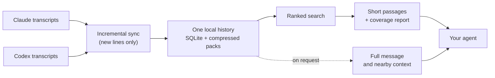
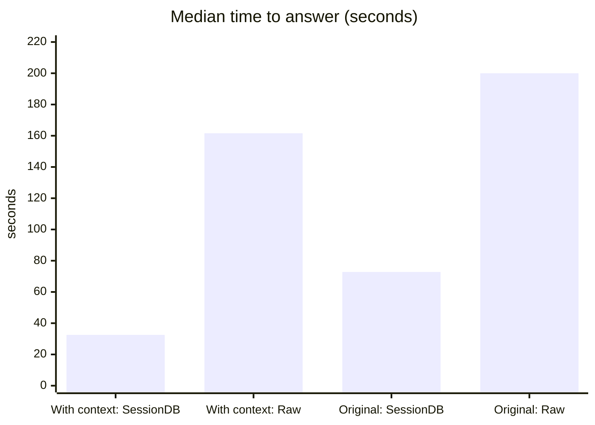

# SessionDB

**Let your AI agents remember what you already did, across Claude and Codex.**

SessionDB turns your local Claude Code and Codex transcripts into one searchable history. An agent starting a new session can ask "what did we decide about X last week?" and get the relevant messages back, with a reference to exactly where each one came from. In tests on real history questions, agents using SessionDB answered 2.7–5 times faster than agents searching raw transcripts, with about 30–40% fewer tokens.

It runs entirely on your Mac, needs no server or account, and never moves or deletes your transcripts.

---

## The problem: searching raw transcripts

Claude Code and Codex save every session as transcript files. That history is valuable (decisions, fixes, commands that worked), but getting it back is slow and unreliable:

- **Two formats, many files.** Claude and Codex lay out and structure their records differently. An agent has to know both, and one decision can be spread across several sessions.
- **Mostly noise.** Each transcript repeats the same system instructions, tool definitions and long tool output. A text search hits all of it, and the agent spends its context reading text it doesn't need.
- **No ranking, no follow-up.** `grep` or `rg` returns lines, not answers. Filtering by project, date or role, reading surrounding messages, and citing the source are all manual.
- **Silent gaps.** A file still being written, an unreadable line or a new record shape can drop out of a search unnoticed. "No match" then looks like "never happened".

## The solution: one history, one search, both providers



| What it does | Why it matters |
| --- | --- |
| **One store for both providers** | Search Claude and Codex together, with the same filters for provider, project, session, date, role and tool |
| **Deduplication** | Content repeated across messages and sessions (instructions, tool output, attachments) is stored once and compressed |
| **Ranked search** | Phrases, `AND` / `OR` / `NOT`, nearness, and accent-aware English and Vietnamese matching; exact phrases and close matches rank first |
| **Passages first, details on demand** | The agent reads up to ten short passages, then opens only the messages it needs |
| **Traceable evidence** | Every result points to its session, source file and line |
| **Honest coverage** | Each answer states whether every relevant file was searched; if not, it names the exact file and where to resume |
| **Stays current** | A watcher adds new transcript lines as they're written; even a session still in progress can be searched |
| **Redacted output** | Secrets and long encoded values are masked in search results |

---

## Performance

### SessionDB vs raw transcripts

**Agents using SessionDB answered 2.7–5 times faster with fewer tokens.** With the question's context included, they were also right every time. Same agent (Claude Opus 5.5) on both sides, two sets of real history questions:

| Per lookup (median) | With context: SessionDB | With context: Raw | Original requests: SessionDB | Original requests: Raw |
| --- | ---: | ---: | ---: | ---: |
| Answer fully correct | **40 of 40** | 37 of 40 | 27 of 28 | 28 of 28 |
| Time to answer | **32.5 s** | 161.6 s | **72.8 s** | 200 s |
| Answered within 40 s | **30 of 40** | 6 of 40 | 2 of 28 | — |
| Tokens processed (mostly cached input) | **65 k** | 107 k | **160 k** | 237 k |
| Tool calls | 3 | 7 | 6.5 | 9.5 |
| Runs that also opened raw transcripts | 1 of 40 | — | 4 of 28 | — |



What this means:

- **Questions with their context included** (the closest to asking an agent in a session that already knows what you mean): SessionDB was faster in 35 of 40 runs, at a median 0.20× the time and 0.61× the tokens per question.
- **Original requests with little or no context** ("that issue from before", often the first message of a session): SessionDB was faster in 26 of 28, at 0.38× the time and 0.69× the tokens. One answer picked an older, similar incident than the one meant; raw search got that one right. Real use is likely between the two sets.
- **Raw transcripts are rarely needed.** Most extra raw reads re-checked text SessionDB had already found; one computed per-turn token statistics, which SessionDB doesn't aggregate. The one held-out case was a search that ran out of time, since fixed.
- **Reruns after the fixes** (only the 6 questions above that missed or opened raw files; one or two runs each; the tables above remain the measured totals):
  - *Time-out fix:* the held-out question that ran out of time answered without raw files in all 4 later runs (3 correct, 1 picked a different session).
  - *`grep`, `sessions`, `record-stream`:* every raw read had been grep, a script on one session's records, or listing sessions by date or title. With these commands named in the agent instructions, agents used them instead (over 40 `grep` and 16 `record-stream` calls in 7 runs); all 5 original requests were answered correctly, and the wrong-incident request was right in both reruns.
  - *Still open:* agents sometimes list the session folder (`ls`) to see file names, and one question came back partial twice (right session, one detail missing).

<details>
<summary>How it was measured</summary>

- **Questions:** real requests from the author's Claude and Codex sessions (June to October 2026) whose answer was in an earlier session, not in repository files at the time.
  - *With context included:* 20 questions kept aside and never used while tuning SessionDB, each rewritten to stand alone while keeping the author's wording; two runs per question. An independent reviewer checked every expected fact against the source lines. Mixed English and Vietnamese, half Claude and half Codex.
  - *Original requests:* 28 requests exactly as asked; 17 were the first message of a session, 11 included up to 20 earlier messages as plain text (no tool output or files, so less context than a real session). One run per question; the raw-transcript figures come from an earlier run on the same questions.
- **Fair setup:** each agent saw history only up to the moment of the original request, through a frozen copy cut at that time. Both had the same prompt frame, tools (shell, Grep, Glob, Read) and limits; the SessionDB agent followed the instructions in the setup guide below and could still open raw files.
- **Grading:** a separate Opus 5.5 grader judged each final answer against the expected facts without knowing which method produced it.
- **Limits:** one model, one person's history, measured on 8 October 2026 with the private build this release is extracted from. Codex agents were not tested.

</details>

### Search speed

**This release (0.1.0rc1), measured on 2,000 invented records** on one Mac. Medians of ten runs after two warm-ups; results were identical to the private build it was extracted from.

| Operation | Time |
| --- | ---: |
| Phrase search `"release checklist"` | 118 ms |
| Boolean search `backup AND verified` | 34 ms |
| Vietnamese phrase `"ghi chú"` | 139 ms |
| Sync the 2,000 records | 551 ms |
| Build the search index | 536 ms |

**The private build, on the author's real history (7 October 2026).** Same search engine, measured before packaging; not re-measured on this release. Search times are single runs.

| Measure | Result |
| --- | --- |
| History size | 971,498 events from Claude and Codex |
| Disk use | 5.1 GB for the database and search index vs 5.9 GB of transcripts (13% smaller). Saved search results, snapshots and test data added another 1.4 GB |
| Phrase searches | 0.6 s for `"release checklist"` (72 matches); 1.0 s for `"báo giá"` (3,577) |
| Word searches | 4.5–4.7 s for `khách hàng` (4,264) and `cleanupPeriodDays` (2,729) |
| Very common word | 11.9 s for `error` (47,494 matches) |

Your results depend on how much history you have, your hardware, and how common your search words are.

## Trade-offs

| Trade-off | What to expect |
| --- | --- |
| **Vague requests can still pick the wrong session** | With little context, an agent may choose an older, similar incident than the one meant (1 of 28 in the benchmark above, where raw search got it right). Naming a date, project or detail avoids it |
| **Agents still need good instructions** | Having the evidence in the database doesn't guarantee an agent uses it. Without the instructions in the setup guide below, agents read too much, fall back to raw transcripts, or leave out a fact they saw |
| **Disk space** | SessionDB keeps its own copy of your history. It was smaller than the raw transcripts on the author's data, but that is not guaranteed, and you keep the transcripts too |
| **Setup and first sync** | History must be synced before it can be searched; a large history takes a while the first time |
| **Some searches are slow** | Very common words can take over 10 s on a large history. Search stops at 30 s by default and says it ran out of time, so the agent can narrow the search, rather than returning a partial answer |
| **Coverage can be incomplete** | Unreadable, unsupported or still-changing files are reported, not hidden. Incomplete coverage can't prove that something never happened |
| **Still sensitive data** | Results are redacted on a best-effort basis; the database itself contains everything. Don't share it |
| **Platform** | Tested on macOS only. Linux and Windows are unverified |

---

## Setup guide for AI agents

Give this section to Claude Code or Codex ("set up SessionDB using the README") or follow it yourself. Each step has a check; stop and report to the user if a check fails.

**1. Check prerequisites.** macOS, Python 3.9 or newer, and SQLite with FTS5:

```sh
/usr/bin/python3 -c "import sqlite3; sqlite3.connect(':memory:').execute('create virtual table t using fts5(x)'); print('ok')"
```

Prefer `/usr/bin/python3` (the tested 3.9). A very new Python, such as 3.14, may fail to build the pinned `tiktoken` dependency.

**2. Install into its own environment** from a checkout of this repository:

```sh
/usr/bin/python3 -m venv ~/.local/share/sessiondb/venv
~/.local/share/sessiondb/venv/bin/python -m pip install .
```

Check: `~/.local/share/sessiondb/venv/bin/sessiondb --help` prints usage. Installing registers no background jobs.

**3. Sync the user's history once.** This reads `~/.claude/projects`, `~/.codex/sessions`, `~/.codex/archived_sessions` and Codex's thread titles in `~/.codex/session_index.jsonl`, and builds the search index. It only reads transcripts; it never moves or deletes them.

```sh
mkdir -p ~/.local/share/sessiondb/data
~/.local/share/sessiondb/venv/bin/sessiondb-freshness --db ~/.local/share/sessiondb/data/sessiondb.sqlite --once
```

Check: the final status line shows `"coverage_complete": true`. If it lists `blocking_drift_sources` or unsupported content, report them to the user.

**4. Test a search** using a word the user is likely to have discussed:

```sh
~/.local/share/sessiondb/venv/bin/sessiondb --db ~/.local/share/sessiondb/data/sessiondb.sqlite search-index --text 'README'
```

Check: the response has `entries` and `"complete": true`.

**5. Keep it current (ask the user first).** Either run the foreground watcher in a terminal that stays open (stop it with Control-C), or rerun step 3 before lookups:

```sh
~/.local/share/sessiondb/venv/bin/sessiondb-freshness --db ~/.local/share/sessiondb/data/sessiondb.sqlite
```

Without the watcher, searches still work: newer transcript lines are reported as `affected_sources` instead of being silently missed.

**6. Teach your agents to use it.** With the user's approval, add this to their global agent instructions (`~/.claude/CLAUDE.md` for Claude Code, `~/.codex/AGENTS.md` for Codex):

````markdown
## Past sessions (SessionDB)
To find earlier Claude or Codex work, use SessionDB:
`~/.local/share/sessiondb/venv/bin/sessiondb --db ~/.local/share/sessiondb/data/sessiondb.sqlite <command>`
1. Search: `search-index --format text --text '<2-4 distinctive words>'`. If the request gives a session ID, date, or exact string, filter by it (`--session`, `--since`/`--until`, quoted text). Words combine with AND; use `a OR b` and `'"exact phrase"'`; `--role user|assistant` limits the speaker.
2. To find where an exact string first or ever appeared, search it in quotes with `--order chronological`. Inside one session, search it (`--session <id>`) instead of reading through it. For anything you would do with grep, rg, or a script on transcript files, use `grep '<regex>'` (`-F` exact text, `-i`, `-l` lists sessions with counts and first and last times, `--session`, `--since`/`--until`) or `record-stream --session <id> --output -` (the session's original records, one JSON object per line). To list sessions by date or title, use `sessions --since <date> --until <date>` or `sessions --title '<words>'`.
3. Read when the shown evidence is not enough: run the session's ready `read … --line L --evidence` command. `--full` shows one record unabridged; `read --session <id> --tail 1` prints its title, time span, app, model and folder.
4. When several sessions match, choose the one that fits every detail the request gives; prefer the most recent only when asked for the latest or current state.
5. Before answering, check each requested claim against a record you read, and say plainly when one is not in the history.
Open raw transcripts only when a result says `coverage incomplete` or `not yet indexed` (only those files, from the byte given), or for data SessionDB does not hold; say which files and why. With complete coverage, a no-match shows only that the indexed text lacks those words.
````

---

## Try it with the example data

To see SessionDB without touching your own history, use a separate database and the invented conversations in `examples/`:

```sh
python3 -m venv .venv
.venv/bin/python -m pip install .
mkdir -p demo-data
.venv/bin/sessiondb --db demo-data/demo.sqlite ingest --provider claude examples/claude.jsonl
.venv/bin/sessiondb --db demo-data/demo.sqlite ingest --provider codex examples/codex.jsonl
.venv/bin/sessiondb --db demo-data/demo.sqlite build-search-index
.venv/bin/sessiondb --db demo-data/demo.sqlite search-index --text '"release checklist"'
```

The search returns these two passages, with identifiers and coverage metadata:

> Where is the release checklist?
>
> The release checklist requires tests and documentation. Ghi chú phát hành đã sẵn sàng.

The second passage is recorded text from the example, not an answer generated by SessionDB. Because the demo imports files directly instead of running the watcher, it reports incomplete overall coverage (`complete: false`, `reason: "missing"`). The returned passages are still valid evidence.

## Retrieval reference

### Search, check coverage, retrieve evidence

A typical lookup runs `search-index`, checks coverage, and follows result identifiers to selected details.

- `entries` contains the inline passages. `snapshot_id` identifies the search snapshot; `bundle.path` locates the saved result bundle.
- Short identifiers such as `r1` and `r2` are aliases resolved through that bundle. They are not interchangeable between searches.
- `follow_up.details` supplies the parameters for detail retrieval, including the database, snapshot, bundle, and suggested readable query.
- `complete`, `reason`, and `coverage` describe the evidence available for the requested scope. Incomplete coverage is different from having no matching records.
- `has_more`, `shown_through`, and bundle paging describe delivery. The inline preview is not necessarily the whole result set, and `total` may be unknown.

For the demo search, retrieve the second result using the `snapshot_id` and `bundle.path` from that response:

```sh
.venv/bin/sessiondb --db demo-data/demo.sqlite details \
  --snapshot-id '<snapshot_id>' \
  --bundle '<bundle.path>' \
  --result-id r2 --readable
```

Readable details show redacted content without the provider envelope; the default format keeps the event structure. Add nearby messages with `--before` and `--after`; continue long text with `--readable-offset`.

### Commands

| Command | Purpose | Selected options |
| --- | --- | --- |
| `ingest` | Import one provider transcript | `--provider`, source file path |
| `build-search-index` | Build searchable projections for stored events | `--readiness-receipt` for large rebuilds |
| `search-index` | Ranked passages with evidence references | `--text`, `--order`, `--limit`, `--format text`, scope filters |
| `read` | A session's conversation as compact text: around a record, its evidence, one record in full, or its end | `--session`, `--line`, `--evidence`, `--full`, `--tail`, `--role`, `--tools` |
| `bundle-page` | Read more entries from a saved search bundle | `--bundle`, `--offset`, `--limit`, `--format text` |
| `details` | Retrieve selected messages and context | `--snapshot-id`, `--result-id`, `--bundle`, `--readable` |
| `query` | List filtered events with paging | `--clean`, `--page-envelope`, `--limit`, `--offset` |
| `grep` | Every stored record matching a regex or exact text, with surrounding text, or the sessions that match with counts and first and last times | `-F`, `-i`, `-l`, `-C`, `-m`, `--session`, `--since`, `--until` |
| `sessions` | Sessions active in a time window, or whose title has given words | `--since`, `--until`, `--title`, `--provider` |
| `record-stream` | Stored provider records; `--output -` prints a session's original records one per line for scripts | `--session`, `--category`, `--output` |
| `report` | Inspect the database | See command help |

Search and query filters include `--provider`, `--project`, `--session`, `--role`, `--tool`, `--lineage`, `--since`, and `--until`; a date alone means that whole day (UTC). Relevance order is the default; chronological order is available. `--format text` groups results by session for agents to read, with a ready `read` command for each. Command help is the full reference:

```sh
.venv/bin/sessiondb search-index --help
.venv/bin/sessiondb details --help
.venv/bin/sessiondb bundle-page --help
```

## Operations

### Watcher

`sessiondb-freshness` discovers `~/.claude/projects`, `~/.codex/sessions`, `~/.codex/archived_sessions`, and Codex's title index `~/.codex/session_index.jsonl`. With `--once` it syncs once; without it, it runs in the foreground until stopped. Status is written to `freshness/watcher_status.json` beside the database. No scheduler, messaging service, or repair agent is registered or launched.

Records being written may be reported as catching up. Persistent drift, unreadable evidence, failed migrations, and unsupported content-bearing shapes stay visible and can make affected queries incomplete. An issue with one provider does not invalidate evidence from the other.

### Export and backup

`sessiondb-export` creates a bounded, redacted portable snapshot. It syncs discovered session roots first, so use it only with a database and account you intend to index. `sessiondb-admin backup` backs up a database including its packs. Review snapshots and backups before sharing.

```sh
.venv/bin/sessiondb-export --help
.venv/bin/sessiondb-admin backup --help
```

### Large rebuilds

Rebuilds of 100,000 events or more require a current, one-use readiness receipt from `scripts/rebuild_readiness.py`. It binds the code revision, reviewed plan, corpus identity, tests, sample queries, tokenizer, and available disk space, and runs from a clean, committed Git checkout that contains the tests. Its review JSON contains `reviewer`, `outcome: approved`, `material_changes_reviewed: true`, `reviewed_revision`, and `plan_sha256`. Do not fabricate a review receipt to bypass review.

```sh
PYTHONPATH=src .venv/bin/python scripts/rebuild_readiness.py --help
```

## Privacy and release status

SessionDB runs locally, but its stored content can include credentials, customer information, or other private material.

- Redaction is best-effort. Redacted results do not make the database or packs safe to share.
- Keep databases, packs, result bundles, snapshots, and watcher status files private.
- Normal syncing never moves or deletes transcripts. When a provider confirms it deleted a session, SessionDB removes that session's indexed records and derived copies; keep backups if recovery matters.

This is the first standalone release candidate, **`0.1.0rc1`**, under the [MIT license](LICENSE). It includes local sync, storage, search, evidence retrieval, export/backup, and a foreground macOS watcher. Automatic agent repair, external notifications, scheduled nightly audits, agent benchmarks, and the walkthrough app are not included.

All 276 synthetic tests pass, including installed commands and native macOS watcher events. See the [release scope](docs/release/Release%20scope.md), [verification report](docs/release/Verification%20results.md), and [recorded measurements](docs/release/synthetic-performance.json).

## Development

| Location | Contents |
| --- | --- |
| `src/` | Library and command-line tools |
| `tests/` | Synthetic tests |
| `examples/` | Invented Claude and Codex records |
| `scripts/` | Rebuild-readiness tooling |
| `docs/release/` | Release scope, extraction manifest, verification, and measurements |

Run the test suite:

```sh
PYTHONPATH=src .venv/bin/python -m unittest discover -s tests
```

For installed-command tests, set `SESSIONDB_TEST_BIN` to the virtual environment's `bin` directory. When another SessionDB installation exists, test with an isolated home and database or a separate account. Retained and omitted tests are listed in the [extraction manifest](docs/release/extraction-manifest.json).
